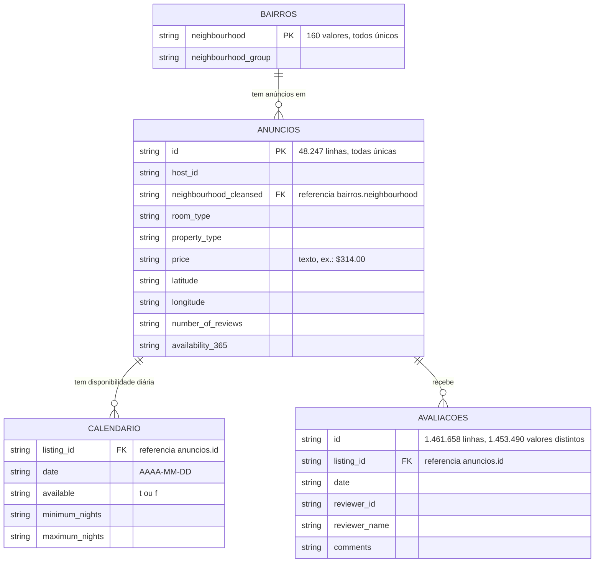

# Diagrama entidade-relacionamento: camada raw

Escrito para: quem vai montar consultas e a etapa de staging sobre o schema `raw`.

Renderiza no GitHub e na extensão de Markdown do VS Code (Mermaid).

## Notas sobre as chaves

- **Relações confirmadas nos dados brutos:**
  - Todos os 48.247 anúncios têm `neighbourhood_cleansed` presente em `bairros.neighbourhood`.
  - Todas as avaliações têm `listing_id` presente em `anuncios.id`.
- **`calendario` não tem chave primária declarada.** A combinação (`listing_id`, `date`) deveria ser única, mas ainda não foi verificada nos 17,6 milhões de linhas.
- **`avaliacoes.id` não é único:** há 8.168 valores repetidos. Ver a decisão 1 em `docs/spec/06_staging_spec.md`.
- **Todas as colunas são texto** no `raw` (`VARCHAR`), inclusive as chaves. Os tipos só serão definidos na etapa de staging.
- `anuncios` tem 90 colunas no arquivo original. O diagrama mostra só as chaves e algumas colunas; a lista completa está em `data/raw/listings.csv.gz`.
