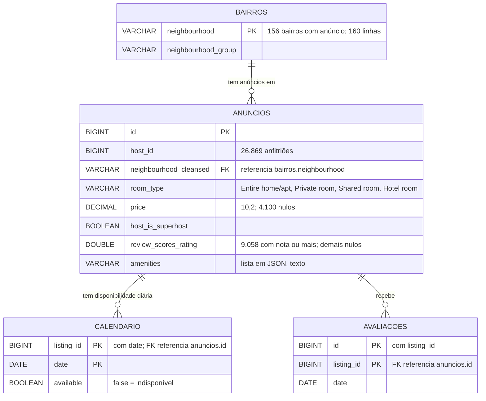

# Spec da etapa 3: marts (insideairbnb)

Status: APROVADA. Não há pontos [DECIDIR] em aberto.

Escrito para: quem vai construir a etapa 3 e quem vai ler as respostas às
perguntas de negócio.

## CONTEXTO

A etapa 1 guardou o dado que chegou em `raw` (texto). A etapa 2 converteu e
validou em `staging` (tipos definidos, chaves conferidas). A etapa 3 responde
perguntas de negócio sobre o staging. Cada pergunta vira uma tabela em `mart`.

A fronteira é: `staging` = o dado decidido; `mart` = a resposta a uma pergunta.
Nada em `mart` é corrigido de volta em `staging` ou `raw`.

## STACK

- Python 3.13, dependências gerenciadas com uv.
- DuckDB, arquivo `data/insideairbnb.duckdb`.
- Consultas em SQL no DuckDB, disparadas pelo Python. O dado já está no banco.
- Nenhum orquestrador. Script executável pela linha de comando.
- pytest e ruff, como nas etapas anteriores.

## O QUE JÁ EXISTE (use, não reimplemente)

Recursos criados nas etapas 1 e 2.

`src/pipeline/db.py`:

- `caminho_banco() -> Path`: caminho de `data/insideairbnb.duckdb`.
- `conectar() -> duckdb.DuckDBPyConnection`: abre o banco, cria o schema `raw`,
  define `memory_limit = '2GB'`.
- `gravar(con, nome_qualificado, df) -> int`: `CREATE OR REPLACE TABLE` a partir
  de um DataFrame.

`src/pipeline/staging.py`:

- `TABELAS`, `REGRAS`, `CHAVES`: tabelas, colunas e chaves do staging.
- `transformar(con)`: grava `staging.anuncios`, `staging.calendario`,
  `staging.avaliacoes`, `staging.bairros` numa única transação.

Schema `staging`, quatro tabelas (contagens da execução real, etapa 2):

| Tabela | Linhas |
|---|---|
| `staging.anuncios` | 48.247 |
| `staging.calendario` | 17.610.155 |
| `staging.avaliacoes` | 1.461.658 |
| `staging.bairros` | 160 |

Período do calendário: 2026-09-23 a 2027-09-28, 365 dias para cada um dos
48.247 anúncios. Período das avaliações: 2010-06-07 a 2026-09-29.

## MER DO STAGING

Diagrama com as chaves e os campos usados pelas perguntas. A lista completa de
colunas está em `docs/spec/06_staging_spec.md`.



Relações conferidas na etapa 2: nenhum `avaliacoes.listing_id` nem
`calendario.listing_id` sem anúncio; nenhum `anuncios.neighbourhood_cleansed`
sem bairro.

## ARTEFATOS A PRODUZIR

Entregáveis:

- `src/pipeline/marts.py`, executável com `uv run python -m pipeline.marts`.
- Schema `mart` com nove tabelas: uma para cada pergunta, e a sazonalidade da pergunta 5 em tabela própria (seção PERGUNTAS).
- Nove arquivos SQL em `data/mart/`, um por mart, com o nome `XX_descricao_do_mart.sql`
  (seção ARQUIVOS SQL).
- Testes em `tests/test_marts.py`, com `tmp_path`; nunca tocam no `.duckdb` real.

Regras gerais:

M1. Cada tabela de `mart` é recriada com `CREATE OR REPLACE TABLE` a partir de
`staging`. Rodar duas vezes dá o mesmo resultado.

M2. As nove tabelas são gravadas numa única transação, como na etapa 2. Se uma
falhar, nenhuma é alterada.

M3. Nenhuma consulta de `mart` escreve em `staging` ou `raw`.

M4. Valores de preço e nota nulos são excluídos apenas das médias e medianas
que dependem deles. A contagem de anúncios mostra quantos ficaram de fora.

M5. Percentuais têm duas casas decimais. Preços e receitas são `DECIMAL`.

M6. Os nomes das colunas de saída são em português, em `snake_case`.

M7. `marts.py` executa os arquivos de `data/mart/` em ordem numérica (01 a 09).
Cada arquivo contém uma única instrução `CREATE OR REPLACE TABLE mart.<nome> AS ...`.
O Python não contém SQL de mart: o SQL vive nos arquivos.

## ARQUIVOS SQL

Pasta: `data/mart/`. Nome: `XX_descricao_do_mart.sql`, em que `XX` é um número
sequencial começando em 01.

| Arquivo | Mart (tabela) | Pergunta |
|---|---|---|
| `01_preco_bairro.sql` | `mart.preco_bairro` | 1 |
| `02_ocupacao_bairro.sql` | `mart.ocupacao_bairro` | 2 |
| `03_receita_mensal_anuncio.sql` | `mart.receita_mensal_anuncio` | 3 |
| `04_multi_host.sql` | `mart.multi_host` | 4 |
| `05_reviews_mensal.sql` | `mart.reviews_mensal` | 5 |
| `06_inteiro_vs_privado.sql` | `mart.inteiro_vs_privado` | 6 |
| `07_superhost.sql` | `mart.superhost` | 7 |
| `08_amenities.sql` | `mart.amenities` | 8 |
| `09_sazonalidade_reviews.sql` | `mart.sazonalidade_reviews` | 5 (média por ano) |

Cada arquivo começa com um cabeçalho de comentários (mart, pergunta, fonte,
regras) e tem o SQL da seção da pergunta correspondente, envolvido por
`CREATE OR REPLACE TABLE mart.<nome> AS`. O arquivo 09 é a média por ano da
pergunta 5; o arquivo 05 é a série mensal.

Os arquivos ficam versionados no git: a linha `data/mart/` foi retirada do `.gitignore`.

## PERGUNTAS E SQL

Os SQL abaixo rodaram sobre o staging da etapa 2 e devolveram o resultado de
referência indicado. Cada um vira `CREATE OR REPLACE TABLE mart.<nome> AS ...`.

### 1. Preço médio e mediano da diária por bairro

Tabela: `mart.preco_bairro`. Base: `staging.anuncios.price` (preço por noite).

```sql
SELECT neighbourhood_cleansed AS bairro,
       count(price) AS anuncios_com_preco,
       round(avg(price), 2) AS preco_medio,
       round(quantile_cont(CAST(price AS DOUBLE), 0.5), 2) AS preco_mediano
FROM staging.anuncios
WHERE price IS NOT NULL
GROUP BY 1
ORDER BY 1;
```

Resultado de referência: 156 bairros. Soma de `anuncios_com_preco` = 44.147.

### 2. Taxa de ocupação estimada por bairro

Tabela: `mart.ocupacao_bairro`. Taxa = dias com `staging.calendario.available =
false` sobre dias totais do calendário, por bairro. Conta reservas e bloqueios do
anfitrião. É o único indicador de ocupação: não há outra fonte independente.

```sql
WITH cal AS (
    SELECT listing_id,
           count(*) FILTER (WHERE NOT available) AS dias_indisponiveis,
           count(*) AS dias
    FROM staging.calendario
    GROUP BY 1
)
SELECT a.neighbourhood_cleansed AS bairro,
       count(*) AS anuncios,
       round(100.0 * sum(c.dias_indisponiveis) / sum(c.dias), 2) AS taxa_ocupacao_pct
FROM staging.anuncios a
JOIN cal c ON c.listing_id = a.id
GROUP BY 1
ORDER BY 1;
```

Resultado de referência: 156 bairros.

### 3. Receita potencial mensal por anúncio

Tabela: `mart.receita_mensal_anuncio`. Receita = preço do anúncio × dias
ocupados no mês. O calendário não traz preço por dia; usa-se o preço do anúncio
para o ano inteiro.

```sql
SELECT a.id AS listing_id,
       date_trunc('month', c.date) AS mes,
       count(*) FILTER (WHERE NOT c.available) AS dias_ocupados,
       round(a.price * count(*) FILTER (WHERE NOT c.available), 2) AS receita_potencial
FROM staging.calendario c
JOIN staging.anuncios a ON a.id = c.listing_id
WHERE a.price IS NOT NULL
GROUP BY a.id, a.price, 2
ORDER BY 1, 2;
```

Resultado de referência: 573.911 linhas (anúncio × mês com preço).

### 4. Fatia de anfitriões com mais de um imóvel

Tabela: `mart.multi_host`. Anfitrião é `host_id`. Multi-host é anfitrião com
mais de um anúncio.

```sql
WITH h AS (
    SELECT host_id, count(*) AS imoveis
    FROM staging.anuncios
    GROUP BY 1
)
SELECT count(*) AS anfitrioes,
       count(*) FILTER (WHERE imoveis > 1) AS multi_host,
       round(100.0 * count(*) FILTER (WHERE imoveis > 1) / count(*), 2) AS fatia_multi_host_pct,
       round(100.0 * sum(imoveis) FILTER (WHERE imoveis > 1) / sum(imoveis), 2) AS fatia_imoveis_multi_pct
FROM h;
```

Resultado de referência: 26.869 anfitriões; 6.411 multi-host (23,86%); esses
anfitriões têm 57,60% dos imóveis.

### 5. Evolução mensal do número de reviews (sazonalidade)

Tabela: `mart.reviews_mensal`. Duas medidas: a série mensal completa e a média
por mês do ano, para ver a sazonalidade.

```sql
SELECT date_trunc('month', date) AS mes, count(*) AS reviews
FROM staging.avaliacoes
GROUP BY 1
ORDER BY 1;
```

Sazonalidade (todo o histórico disponível, com média por ano): para cada mês do
ano, conta-se as reviews de cada ano em que o mês tem dados e tira-se a média
desses anos. Assim, cada mês pesa pelo número de anos em que existe, e não pela
soma de anos desiguais (2026 é incompleto):

```sql
WITH mensal AS (
    SELECT extract(year FROM date) AS ano,
           extract(month FROM date) AS mes_do_ano,
           count(*) AS reviews
    FROM staging.avaliacoes
    GROUP BY 1, 2
)
SELECT mes_do_ano,
       round(avg(reviews), 1) AS media_reviews_por_ano,
       count(*) AS anos_com_dados,
       sum(reviews) AS total_reviews
FROM mensal
GROUP BY 1
ORDER BY 1;
```

Resultado de referência: 196 meses na série completa (série mensal, primeira
consulta). Na média por ano, o mês de maior volume é janeiro (9.879 reviews por
ano, em média) e o de menor é dezembro (5.795); setembro (8.667) é o segundo
maior. Os meses têm 16 ou 17 anos com dados, conforme o mês.

Nota: 2026 entra na média de janeiro a setembro, com dados até 29/09/2026.
A média de cada mês usa os anos que têm dado nele, não um número fixo de anos.

### 6. Imóvel inteiro versus quarto privado

Tabela: `mart.inteiro_vs_privado`. Compara `Entire home/apt` com `Private room`.
A diferença é dada em percentual sobre o quarto privado.

```sql
SELECT room_type AS tipo,
       count(*) AS anuncios,
       round(avg(price), 2) AS preco_medio,
       round(quantile_cont(CAST(price AS DOUBLE), 0.5), 2) AS preco_mediano
FROM staging.anuncios
WHERE price IS NOT NULL
  AND room_type IN ('Entire home/apt', 'Private room')
GROUP BY 1
ORDER BY 1;
```

Resultado de referência: inteiro 36.148 anúncios, média 948,39, mediana 491,00;
quarto privado 7.455 anúncios, média 481,95, mediana 290,00. Diferença do
inteiro sobre o privado: 96,8% na média e 69,3% na mediana.

### 7. Superhosts têm notas e ocupação maiores?

Tabela: `mart.superhost`. Compara `host_is_superhost` em nota média e taxa de
ocupação. A nota é `review_scores_rating`; anúncios sem nota ficam fora da média
e aparecem na coluna de contagem.

```sql
WITH cal AS (
    SELECT listing_id,
           count(*) FILTER (WHERE NOT available) AS dias_indisponiveis,
           count(*) AS dias
    FROM staging.calendario
    GROUP BY 1
)
SELECT a.host_is_superhost AS superhost,
       count(*) AS anuncios,
       count(a.review_scores_rating) AS anuncios_com_nota,
       round(avg(a.review_scores_rating), 2) AS nota_media,
       round(100.0 * sum(c.dias_indisponiveis) / sum(c.dias), 2) AS taxa_ocupacao_pct
FROM staging.anuncios a
JOIN cal c ON c.listing_id = a.id
GROUP BY 1
ORDER BY 1;
```

Resultado de referência: não superhost, 30.114 anúncios, nota média 4,75,
ocupação 42,69%; superhost, 18.133 anúncios, nota média 4,89, ocupação 53,13%.

### 8. Quantidade de amenities versus preço e nota

Tabela: `mart.amenities`. A quantidade é o número de itens da lista JSON em
`amenities`. Mede a correlação de Pearson com o preço e com a nota.

```sql
WITH am AS (
    SELECT price,
           review_scores_rating,
           json_array_length(CAST(amenities AS JSON)) AS qtd_amenities
    FROM staging.anuncios
    WHERE amenities IS NOT NULL
)
SELECT count(*) AS anuncios,
       round(corr(qtd_amenities, CAST(price AS DOUBLE)), 3) AS corr_qtd_preco,
       round(corr(qtd_amenities, review_scores_rating), 3) AS corr_qtd_nota
FROM am;
```

Resultado de referência: 48.247 anúncios; correlação com o preço −0,007;
correlação com a nota 0,13.

## PREMISSAS ASSUMIDAS

Itens que não estavam escritos no pedido e foram assumidos nesta spec.
Confirmar ou corrigir.

- Ocupação: dias com `available = false` sobre 365 dias. Conta reservas e
  bloqueios do anfitrião; não há outra fonte para separar os dois.
- O preço é o preço do anúncio para o ano inteiro. O calendário não traz preço
  por dia, então a receita da pergunta 3 é uma estimativa.
- Quando o `price` é nulo, o anúncio sai das perguntas 1, 3 e 6.
- A pergunta 5 usa todo o histórico disponível, como pedido. Isso inclui 2026,
  que é incompleto; ver a ressalva na pergunta 5.
- A pergunta 6 expõe a diferença em percentual sobre o quarto privado.
- A pergunta 8 usa correlação de Pearson, não faixas de quantidade.

## CRITÉRIOS DE ACEITE

- MA1. As nove tabelas existem em `mart`, com as colunas das consultas.
- MA2. Pergunta 1: soma de `anuncios_com_preco` = 44.147 (todos os anúncios com
  preço).
- MA3. Pergunta 2: 156 bairros; nenhum bairro com taxa fora de 0 a 100.
- MA4. Pergunta 3: soma de `dias_ocupados` = 6.843.609 (linhas de
  `staging.calendario` com `available = false` nos anúncios com preço).
- MA5. Pergunta 4: `anfitrioes` = 26.869; `multi_host` = 6.411.
- MA6. Pergunta 5: soma de `reviews` da série mensal = 1.461.658.
- MA7. Pergunta 6: 36.148 + 7.455 = 43.603 anúncios com preço nos dois tipos.
- MA8. Pergunta 7: soma de `anuncios` = 48.247.
- MA9. Pergunta 8: `anuncios` = 48.247 (todos com amenities).
- MA10. Duas execuções seguidas dão o mesmo resultado (M1).
- MA11. Se uma tabela falhar, nenhuma das nove é alterada (M2).

## DECISÕES

Decididas pelo autor da spec:

1. Ocupação: um único indicador, `taxa_ocupacao_pct`, calculado pelo calendário.
   O segundo (`availability_365`) foi descartado: não há fonte independente, e ele
   coincide com o calendário em 99,4% dos anúncios.
2. `mart` como tabelas materializadas, recriadas a cada execução.
3. Sazonalidade (pergunta 5): todo o histórico disponível, com média por ano.
4. Pergunta 6: diferença percentual sobre o quarto privado.
5. Arquivos SQL em `data/mart/`, nomeados `XX_descricao_do_mart.sql` a partir de 01.
6. Sazonalidade (pergunta 5) em tabela própria, `mart.sazonalidade_reviews` (arquivo 09).
7. `data/mart/` versionado no git (linha retirada do `.gitignore`).

Pendências: nenhuma.
